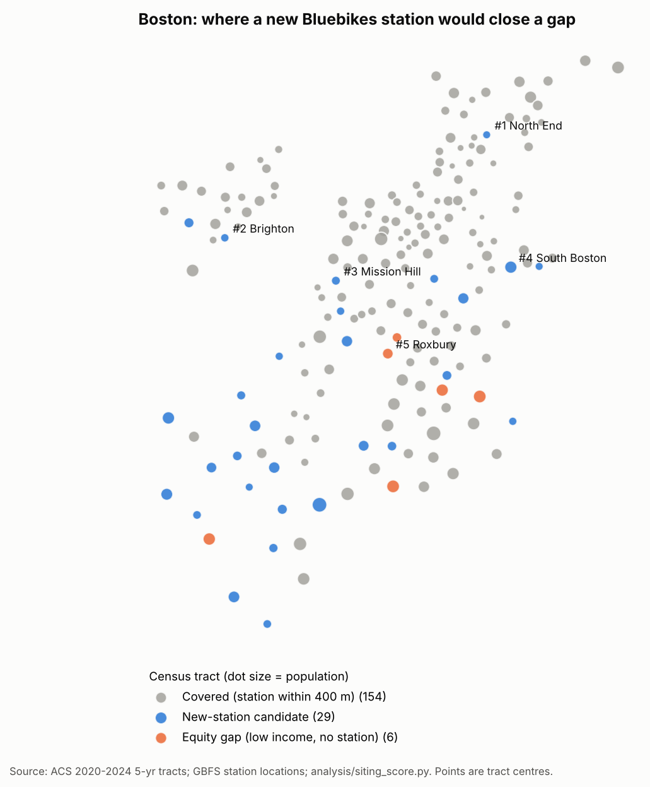
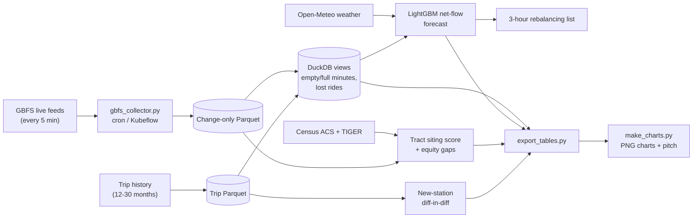

# Bike-share stockouts and station siting (Boston, NYC, Chicago)

**Problem:** when a bike-share station is empty or full, the lost ride leaves no record, so operators
and cities undercount demand exactly where service fails. This project measures those stockouts,
forecasts them, and recommends where Boston should add stations.

Built for the City of Boston Analytics Team (Bluebikes station siting), with Citi Bike (NYC) and
Divvy (Chicago) as benchmarks. Public data only, free tools only.

<!-- SCREENSHOT PLACEHOLDER: replace with dashboard/charts/stockout_heatmap_boston.png once the
     21-day station-status collection ends (~2026-11-23) and make_charts.py has been re-run. -->


## Key findings

1. **The forecast beats "same hour last week" in all three cities.** Station-hour departures error
   (WAPE) on the held-out September 2026 month: Boston **64.7% vs 85.2%**, NYC **46.1% vs 61.1%**,
   Chicago **76.3% vs 94.8%**. In Boston it is better at **550 of 618** stations.
   [`analysis/results/netflow_metrics.csv`]
2. **Boston's core is already covered; the gaps are at the edges.** **154 of 189** populated
   Census tracts have a station within 400 m. Of the **35** that don't, the top picks are the North
   End, Brighton and Mission Hill. Low-income tracts are *better* covered (**13%** lack a station
   within 400 m vs **20%** elsewhere). [`analysis/results/siting/boston_siting_findings.md`]
3. **New stations add rides rather than moving them.** Across 49 Boston openings (stacked
   difference-in-differences), each new station added **+82 rides/week net** (95% CI +45 to +121);
   about **20%** of its rides came from nearby stations. [`analysis/results/new_stations/net_effect.csv`]

Stockout KPIs (station-hours empty/full, estimated lost rides) are pending the end of the
station-status collection window (~2026-11-23).

## Architecture



## Tech stack

Python (pandas, PyArrow), DuckDB SQL, LightGBM, statsmodels, GeoPandas/Shapely, matplotlib,
pytest. Scheduling with cron (Mac) or Kubeflow Pipelines on minikube. Optional Postgres mirror.

## Data sources

| Source | Used for |
|---|---|
| GBFS station status: [Bluebikes](https://gbfs.bluebikes.com/gbfs/gbfs.json), [Citi Bike](https://gbfs.citibikenyc.com/gbfs/gbfs.json), [Divvy](https://gbfs.divvybikes.com/gbfs/2.3/gbfs.json) | Stockouts, live rebalancing (self-collected) |
| Trip history: [Bluebikes](https://s3.amazonaws.com/hubway-data/index.html), [Citi Bike](https://s3.amazonaws.com/tripdata/index.html), [Divvy](https://divvy-tripdata.s3.amazonaws.com/index.html) | Demand, forecast training, new-station study |
| [Census ACS 5-year API](https://api.census.gov/data/2024/acs/acs5) and [TIGER/Line tracts](https://www2.census.gov/geo/tiger/TIGER2024/) | Siting score, equity |
| Neighborhoods: [Boston](https://data.boston.gov/dataset/5997399b-c665-4600-848f-a2a32834f009), [NYC](https://data.cityofnewyork.us/resource/9nt8-h7nd), [Chicago](https://data.cityofchicago.org/resource/igwz-8jzy) | Readable tract labels |
| [Open-Meteo](https://open-meteo.com/) historical and forecast weather | Forecast features |

## How to run

```bash
python -m venv .venv && source .venv/bin/activate
pip install -r requirements.txt
cp .env.example .env                      # add a free Census API key

python ingest/gbfs_collector.py --once    # schedule every 5 min: ingest/scheduling/
python ingest/trips_download.py           # 12 months of trips -> Parquet (~9 min)
python analysis/build_views.py            # DuckDB stockout + lost-ride views
python ingest/weather_download.py history
python models/netflow_features.py && python models/train_netflow.py --ablation
python models/rebalance.py --systems bluebikes --top 25
python ingest/census_download.py && python analysis/tract_station_distance.py && python analysis/siting_score.py
python ingest/station_daily.py --start 2024-04 --end 2026-09 && python analysis/new_station_did.py
python dashboard/export_tables.py && python dashboard/make_charts.py
python -m pytest tests/
```

Each folder's README explains its step: [ingest/](ingest/README.md), [analysis/](analysis/README.md),
[models/](models/README.md), [dashboard/](dashboard/README.md). Requirements and KPIs:
[docs/requirements.md](docs/requirements.md). Six-slide pitch: [dashboard/pitch_outline.md](dashboard/pitch_outline.md).

## What I'd do next

- Finish the 21-day collection and publish the stockout KPIs and estimated lost rides.
- Re-estimate demand from November 2026 trips once published, so lost rides use the same month.
- Replace straight-line distance with walking-network distance (12 of the top 15 siting
  candidates are only 400–500 m from a station).
- With the city's or operator's internal data: rebalancing logs, rejected site lists and exact
  install dates, then pilot forecast-led rebalancing at the top problem stations for 4 weeks.
