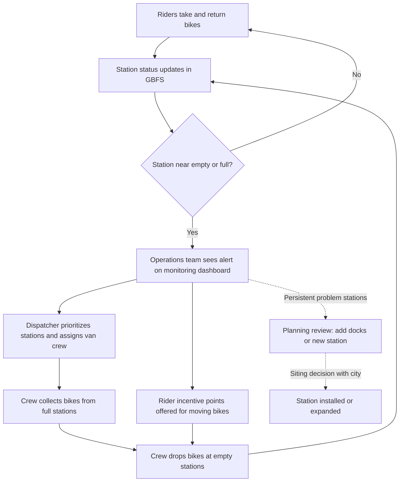

# Requirements: Bike-share stockouts and station siting

**Author:** Khushi · **Status:** Draft v0.2 · **Date:** 2026-11-01
**Systems:** Bluebikes (Boston), Citi Bike (NYC), Divvy (Chicago)

## 1. Problem statement

Docked bike-share fails a rider in two ways: the station has no bikes when they want to start a trip ("empty"), or no open docks when they want to end one ("full"). Each failure is a lost or degraded trip that never shows up in trip records, so it is easy to undercount. Boston also has to decide where new Bluebikes stations should go. This project measures how often stations are empty or full, estimates the rides lost as a result, forecasts station demand, and ranks candidate locations in Boston for new stations. Citi Bike and Divvy serve as benchmarks, since all three systems publish data in the same formats.

## 2. Stakeholders

| Stakeholder | Interest | Role in project |
|---|---|---|
| City of Boston Analytics Team | Evidence for Bluebikes station siting (listed as active work, per project sponsor; *link to be added*) | Primary audience for siting score and recommendations |
| Bluebikes operator | Fewer empty/full stations, better rebalancing | Secondary audience; not a data provider beyond public feeds |
| Riders | Finding a bike or dock when needed | Represented through demand and lost-ride estimates |
| NYC / Chicago transportation agencies | Comparable benchmarks | Context only |

## 3. Business questions

1. **Where and when** do stations go empty or full, and which stations account for most of the problem in each system?
2. **How many rides are likely lost** to empty stations, and how does that compare across the three systems relative to system size?
3. **Can hourly station demand be forecast** well enough to flag likely stockouts several hours ahead, better than a simple "same hour last week" baseline?
4. **Where in Boston** would a new station or added docks capture the most unmet demand, especially in areas with few existing stations?
5. **What patterns** (time of day, weather, proximity to transit) drive stockouts, and do they hold across cities?

## 4. KPIs and definitions

All KPIs come from self-collected GBFS snapshots and official trip history. No baseline values are assumed; they will be measured in the analysis step.

**Station-hours empty.** For each station *s* and snapshot interval *i* of length Δtᵢ (hours), count Δtᵢ when `num_bikes_available = 0` and the station is in service (`is_installed = 1` and `is_renting = 1`). Sum over intervals and stations for a period. Intervals longer than 15 minutes (missed polls) are excluded and reported as a data-coverage percentage. Reported per station, per system, and normalized per 100 stations per day.

**Station-hours full.** Same as above, with the condition `num_docks_available = 0` and `is_returning = 1`.

**Estimated lost rides.** For station *s* and hour-of-week *h*, estimate the departure rate λ(*s*, *h*) from trip history using only hours when the station was never empty (uncensored demand). Then:
lost rides = Σ over station-hours of λ(*s*, *h*) × (fraction of that hour the station was empty).
This is an estimate, not an observation; it is reported with the method stated and a range from the λ estimate's uncertainty.

**Forecast MAPE.** On a time-based holdout period, for station-hours with actual departures ≥ 1:
MAPE = (100 / *n*) × Σ |actual − forecast| / actual.
Station-hours with zero departures are excluded from MAPE because it is undefined at zero, so WAPE (Σ|actual − forecast| / Σ actual) is reported alongside. The model's value is judged against a seasonal-naive baseline (same station, same hour, one week earlier).

**Siting score.** For each candidate cell (a fixed grid or census block group in Boston), score = Σ wₖ · zₖ, where each zₖ is a component scaled to 0–1:
- estimated lost rides at existing stations within walking distance
- distance to the nearest existing station (larger = bigger coverage gap)
- residential population and jobs density (Census ACS / LEHD)
- distance to the nearest MBTA rapid transit or bus stop
- share of households without a vehicle (ACS), as an equity factor

**v1 (Nov 2026):** tract-level score built in Excel and Python from ACS density, car-free commuting, no-vehicle share, age 18–34 share and distance to the nearest station (see `docs/siting_excel_guide.md`); lost rides and MBTA distance are added once the stockout collection finishes.

Weights wₖ start equal, are documented in config, and are tested with a sensitivity analysis so the top-ranked cells can be shown to be stable (or not) under different weightings. The walking-distance radius is a parameter, set and justified in the analysis.

## 5. Data sources

| Source | Content | Use |
|---|---|---|
| GBFS feeds for each system (`station_information`, `station_status`) | Live station capacity, bikes and docks available | Polled on a schedule into our own snapshot history; basis for empty/full KPIs |
| Bluebikes trip history (`s3.amazonaws.com/hubway-data`) | Monthly trip records | Demand rates, forecasting |
| Citi Bike trip history (`s3.amazonaws.com/tripdata`) | Monthly trip records | Benchmark |
| Divvy trip history (`divvy-tripdata.s3.amazonaws.com`) | Monthly trip records | Benchmark |
| US Census ACS 5-year API, LEHD LODES | Population, vehicle access, jobs | Siting score |
| MBTA GTFS | Transit stop locations | Siting score |
| NOAA weather (NCEI daily/hourly) | Temperature, precipitation | Forecast features |
| Analyze Boston (city open data portal) | Boundaries, other city layers as needed | Siting candidate area |

Operators do not publish historical station status, so stockout history starts from when our polling begins. GBFS feed URLs are discovered from each system's `gbfs.json` root on every poll; the roots and the feeds they pointed to on 2026-11-01 are recorded in `ingest/README.md`.

**Tooling (all free, no credit card):** Python and open-source libraries; change-only daily Parquet files read by DuckDB on a laptop for storage (optional local Postgres mirror); GBFS polling every 5 minutes by cron (macOS/Linux) or Task Scheduler (Windows) on the laptop, with a Kubeflow Pipelines recurring-run version for a local minikube cluster; free API keys only (Census); dashboard in Streamlit run locally or Tableau Public.

## 6. Assumptions

- The City of Boston Analytics Team's interest in Bluebikes siting is as stated by the project sponsor; it has not been independently confirmed here.
- GBFS `station_status` reflects reality closely enough at the polling interval; e-bikes and classic bikes both count as "available".
- Departure rates from uncensored hours are a fair proxy for demand during empty hours. This likely understates demand at chronically empty stations.
- The process map below is a generic description of how docked systems rebalance. It is **not** sourced from any operator and should be validated if possible.
- Trip-history formats stay consistent enough across months to combine after cleaning.
- The laptop can sleep, lose Wi-Fi, or be shut down, and feeds can fail, so polling gaps are expected; every poll is logged, gaps are measured by a daily health check and reported as coverage, not hidden.
- Three weeks of status data (three samples of each hour-of-week) is enough for stockout KPIs; demand forecasting relies on trip history, which covers years. A collection started in early November 2026 ends before Thanksgiving week (Nov 26), so the window is not distorted by the holiday; it is also a single season and will not show summer peaks.

## 7. Out of scope

Pricing and membership analysis; operator truck routing or crew scheduling; e-bike battery/charging; dockless scooters and bikes; a production real-time alerting system; siting recommendations outside Boston (NYC and Chicago are benchmarks only); any data that is not public, official, or self-collected.

## 8. Current-state process map (assumed)

This project adds evidence at step C (measured stockouts), at step E (demand forecasts), and at step I (siting score).

## 9. Acceptance criteria

1. GBFS snapshots for all three systems are collected every 5 minutes for at least 21 consecutive days (3 weeks) before KPIs are finalized, with at least 95% of 5-minute slots covered per system; coverage is reported.
2. Station-hours empty and full are computed exactly as defined in Section 4, reproducible from raw files by one documented command.
3. Estimated lost rides are reported per system and for the top stations, with the method and uncertainty range stated.
4. The demand forecast reports MAPE and WAPE on a time-based holdout and is compared to the seasonal-naive baseline; whether it beats the baseline is reported either way.
5. A ranked list and map of Boston candidate cells by siting score is produced, with weights shown and a sensitivity check on the top 10.
6. Every number in the dashboard and README traces to a data source in Section 5; no synthetic or placeholder figures.
7. API keys are read from a git-ignored `.env`; the repo runs from a clean clone with `requirements.txt`.
8. Every tool and service used is free and needs no billing account or credit card.
